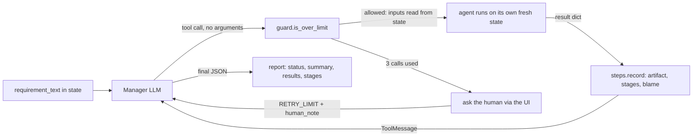
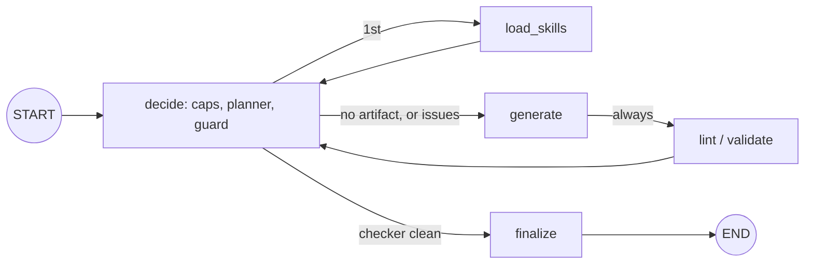
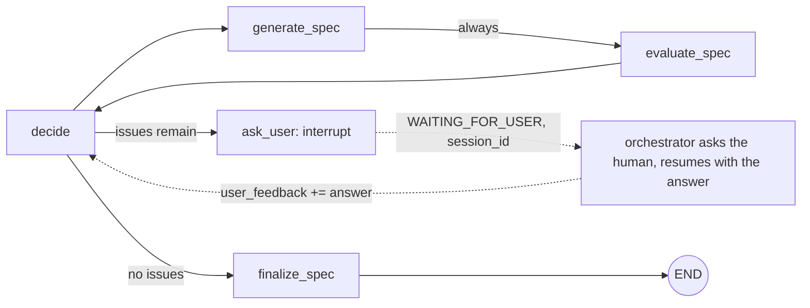
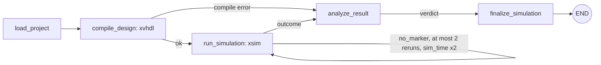
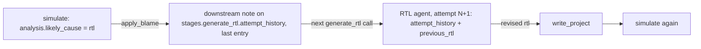

# Hardware Agent: how state is handed between the orchestrator and the agents

*Status as of 2026-11-06. File references are to the `agents/` package. JSON blocks show the exact field names the code builds; example values are illustrative.*

## 1. The shape of the system

One manager AI (the **orchestrator**) runs the other agents as tools. Each agent is a separate LangGraph program with its own state, its own planner and its own checkers. The orchestrator never reaches into an agent's state and no agent reads the orchestrator's state. Everything that crosses the boundary is passed explicitly as function arguments on the way in and returned as a plain result dictionary on the way out.

| Agent | Tool name | Input handed over | Output kept by the orchestrator |
|---|---|---|---|
| Spec analyst | `analyze_spec` | requirement text | `spec` |
| RTL agent | `generate_rtl` | spec, run id, attempt number, attempt history, previous RTL | `rtl` {entity_name, code, notes} |
| Testbench agent | `generate_testbench` | spec, RTL, run id, attempt number, attempt history, previous testbench | `testbench` {entity_name, code, notes} |
| Test-vector agent | `generate_test_vectors` | spec, run id, attempt number, attempt history | `test_vectors` (MATLAB run folder and CSV names) |
| Project writer | `write_project` | spec, RTL, testbench, CSVs | `project_dir` |
| Simulation agent | `simulate` | project folder, sim time | `simulation` {status, verdict, analysis} |
| Implementation agent | `implement` | project folder, FPGA part | `implementation` {verdict, metrics} |

## 2. The orchestrator's state

`orchestrator_agent/state.py` defines one `OrchestratorState` per run, in four groups of fields.

| Group | Fields | Purpose |
|---|---|---|
| Inputs | `requirement_text`, `requirement_id` | what was asked, and the folder-safe run id |
| Artifacts | `spec`, `rtl`, `testbench`, `test_vectors`, `project_dir`, `simulation`, `implementation` | the latest answer of each agent, overwritten on every rerun |
| Per-stage records | `stages[tool name]` = {status, attempts, error, attempt_history, retry_limit} | how every agent went, attempt by attempt |
| Manager control | `status`, `iteration`, `completed_stages`, `errors`, `warnings`, `summary`, `next_steps` | run status, limits and the final report |

`attempt_history` is the key record. Every call to an agent appends one entry: `{attempt, status, error, issues, downstream?, human_note?}`. The `downstream` list is where simulation blame is written (section 12).

## 3. The orchestrator's own loop

The orchestrator is a LangChain `create_agent` tool-calling loop (`orchestrator_agent/orchestrator_agent.py`). There is no fixed order and no decision node: the manager LLM reads each tool's answer in the chat and chooses the next tool itself. Two middlewares wrap every LLM call: one appends the current status board (every stage's status and attempts) to the system prompt, the other ends the run once a final status is reached. The runtime's recursion limit (2 × 25 + 1 steps) is the hard bound.



Every tool call goes through `steps.run_stage`:

1. **Guard.** Artifact stages (spec, RTL, testbench, test vectors) may run 1 + `MAX_RETRIES_PER_STAGE` = 3 times. Beyond that the agent is not run; the human is asked what to do (section 12).
2. **Hand-over.** The inputs are logged and the agent's entry function is called with values read from the state, for example `run_rtl_generation(spec, requirement_id, attempt, attempt_history, previous_rtl)`. The LLM passes only small settings such as `sim_time` or `part`, never artifacts.
3. **The agent runs on its own** and returns a result dictionary (section 4).
4. **Record.** `steps.record` writes the artifact into its field, appends the attempt to `stages[...].attempt_history`, applies simulation blame, and returns the whole result as the tool message the LLM reads next.

## 4. The shape every independent agent shares

All six agents are built the same way (`<agent>/state.py`, `<agent>_agent.py`, `<agent>_decider.py`, `<agent>_guard.py`):

- **State** is a TypedDict with four groups: inputs, working data, stall detection, control/reporting. `initial_state(...)` builds it from the hand-over arguments alone.
- **Graph.** One `decide` node and one node per `Action`. `START → decide`; `decide` routes to the chosen action; every action returns to `decide`, except that a generate node always goes straight to its checker and `finalize` goes to `END`. Any node may set a terminal status, which ends the graph.
- **Decide node.** Checks the iteration cap and the stall cap first. Then the planner LLM proposes an action and the **guard** rules, using only facts in the state, correct it. The planner suggests; the guard has the final say.
- **Stall detection.** The checker fingerprints its issues; two fix rounds with the same fingerprint end the run as NEEDS_REVIEW.
- **Result.** A plain dict (see each agent below); status is COMPLETE, NEEDS_REVIEW or FAILED. The internal state is discarded.



The generate-check agents (sections 7 to 9) use exactly this graph; the run-and-judge agents (sections 10 and 11) replace load_skills/generate/check with load_project, run and analyze.

## 5. Shared data structures, exact JSON

These objects travel between agents. Every input state in sections 6 to 11 is built from them.

### 5.1 `spec` (made by the spec analyser, stored in the orchestrator's `spec`)

```json
{
  "status": "complete",
  "entity_name": "llr_demap16",
  "description": "16-QAM LLR demapper ...",
  "vhdl_version": "2008",
  "ports": [
    {"name": "aclk",         "direction": "input",  "width": "1",  "type": "std_logic"},
    {"name": "aresetn",      "direction": "input",  "width": "1",  "type": "std_logic"},
    {"name": "s_axis_tvalid","direction": "input",  "width": "1",  "type": "std_logic"},
    {"name": "s_axis_tdata", "direction": "input",  "width": "32", "type": "std_logic_vector"},
    {"name": "m_axis_tvalid","direction": "output", "width": "1",  "type": "std_logic"},
    {"name": "m_axis_tdata", "direction": "output", "width": "32", "type": "std_logic_vector"}
  ],
  "clock": {"required": true, "name": "aclk", "frequency_mhz": 100},
  "reset": {"required": true, "name": "aresetn", "type": "synchronous", "active": "low"},
  "behavior":    ["..."],
  "constraints": ["..."],
  "assumptions": ["..."],
  "ambiguities": []
}
```

`status` is `"complete"` or `"needs_clarification"`; `reset.type` is `"synchronous"`, `"asynchronous"` or `null`; `reset.active` is `"high"`, `"low"` or `null`. `vhdl_version` is `"93"` or `"2008"` (filled in by `agents/vhdl_version.py` when the analyser did not set it).

### 5.2 `rtl` and `testbench` (made by the RTL and testbench agents)

```json
{"entity_name": "llr_demap16",    "code": "library ieee; ... end architecture;", "notes": ["..."]}
{"entity_name": "llr_demap16_tb", "code": "library ieee; ... end architecture;", "notes": ["..."]}
```

### 5.3 `lint` / `validation` (made by the checkers)

```json
{"compiler": "xvhdl", "issues": [{"code": "assignment_width", "detail": "line 42: ..."}]}
```

`compiler` is `null` when only the static checks could run. The test-vector validator returns `{"csv": {"inputs": "<path>", "outputs": "<path>"}, "num_vectors": 800, "columns": {"inputs": [...], "outputs": [...]}, "issues": [{"code", "detail"}]}`.

### 5.4 One `attempt_history` entry (written by `steps.record`)

```json
{
  "attempt": 1,
  "status": "COMPLETE",
  "error": null,
  "issues": [{"code": "...", "detail": "..."}],
  "likely_cause": null,
  "downstream": [ /* downstream notes, section 5.5; only when a later simulation blamed this attempt */ ],
  "human_note": "Run generate_rtl once more"   /* only after the retry-limit question */
}
```

`status` is the agent's own status (COMPLETE, NEEDS_REVIEW, FAILED, or WAITING_FOR_USER for the spec analyser). `issues` is the agent's remaining lint/validation issues, or the analysis `failures` for simulate/implement. `likely_cause` is set only on simulate/implement entries.

### 5.5 One downstream note (written by `blame.downstream_note`)

```json
{
  "stage": "simulate",
  "verdict": "fail",
  "failures": ["Error: beat 1 (input cycle 5): m_axis_tdata expected 1040 got 1024"],
  "summary": "two or three sentences from the analyst",
  "suggested_fix": "one concrete step",
  "fixed_rule": "FIXED RULE (not a guess): ...",
  "python_check": {"code": "...python...", "stdout": "CHECK beat=1 ..."},
  "failing_beats": [
    {
      "line": "Error: beat 1 (input cycle 5): m_axis_tdata expected 1040 got 1024",
      "beat": 1,
      "input_row":    {"cycle": "5", "aclk": "1", "aresetn": "1", "s_axis_tvalid": "1", "s_axis_tdata": "1114240"},
      "expected_row": {"cycle": "5", "m_axis_tvalid": "1", "m_axis_tdata": "1040"},
      "input_cycle": "5"
    }
  ],
  "log_excerpt": "Error: beat 1 ...\nError: beat 2 ...\n... [18 more error lines in the run record]",
  "second_opinion": true
}
```

`fixed_rule`, `python_check`, `failing_beats` (max 8 entries) and `log_excerpt` (max 4000 chars) appear only when the analyst produced them. `second_opinion` appears only on a second-opinion note, whose `summary` then starts with "SECOND OPINION: ...". A fixed-cycle compare gives `"cycle": "17"` instead of `"beat"`; a decimating design adds `"input_row_note"`.

### 5.6 `test_vectors` (the whole test-vector agent result, stored as is)

```json
{
  "status": "COMPLETE",
  "requirement_id": "llr_demap16_T-09.15_D-06.11.2026",
  "attempt": 1,
  "run_dir": "C:/.../runs/test_vectors/llr_demap16_20261106_091500",
  "result": {
    "script": "gen_test_vectors.m",
    "input_csv": "test_vectors_in.csv",
    "output_csv": "test_vectors_out.csv",
    "input_columns":  ["cycle", "aclk", "aresetn", "s_axis_tvalid", "s_axis_tdata"],
    "output_columns": ["cycle", "m_axis_tvalid", "m_axis_tdata"],
    "num_vectors": 800,
    "scenarios": ["..."],
    "notes": ["..."]
  },
  "validation": {"csv": {"inputs": "...", "outputs": "..."}, "num_vectors": 800,
                 "columns": {"inputs": [...], "outputs": [...]}, "issues": []},
  "skills_used": ["matlab_golden_model_rules.md"],
  "iteration": 4, "decision_reason": "...", "warnings": [], "error": null
}
```

`write_project` reads `run_dir`, `result.input_csv` and `result.output_csv` from it when `status` is COMPLETE.

### 5.7 `analysis` (made by the simulation analyst; `simulation.analysis`)

```json
{
  "verdict": "fail",
  "likely_cause": "rtl",
  "failures": ["..."],
  "summary": "...",
  "suggested_fix": "...",
  "fixed_rule": "...",
  "python_check": {"status": "ok", "code": "...", "stdout": "...", "stderr": ""},
  "overridden_cause": "testbench",
  "failing_beats": [ /* as in 5.5 */ ],
  "log_excerpt": "..."
}
```

`verdict` is `"pass"`, `"fail"` or `"error"`; `likely_cause` is `"rtl"`, `"testbench"`, `"test_vectors"`, `"spec"`, `"environment"` or `null`. `overridden_cause` records the LLM's cause when a code rule replaced it. The optional fields appear only when produced.

## 6. Spec analyser agent

Input state, exactly as `initial_state(request)` builds it:

```json
{
  "original_request": "Design a 16-QAM LLR demapper ...",
  "user_feedback": [],
  "spec": null,
  "issues": [],
  "suggestions": [],
  "answers_applied": 0,
  "issue_signature": null,
  "stall_count": 0,
  "status": "RUNNING",
  "pending_question": null,
  "iteration": 0,
  "last_action": null,
  "decision_reason": null,
  "error": null
}
```

On a resume, `user_feedback` gains the person's answer as a string and the graph continues from the checkpoint.



- **Guard rules.** Generate first when there is no spec or new answers are waiting; never finalize with issues (ask instead); a regeneration that changed nothing once turns into ask_user; an ask without a question gets one built from the issues.
- **Hand-over.** `tools.analyze_spec_with_user` runs the analyser, and while the result is WAITING_FOR_USER it asks the person through the UI and resumes the same session by `session_id`. Only this agent is checkpointed across calls, because it pauses.
- **Returns** `{"session_id", "status", "pending_question", "spec", "issues", "suggestions", "user_feedback", "iteration", "decision_reason", "error"}`; the orchestrator keeps `spec` (section 5.1).

## 7. RTL agent

Input state, exactly as `initial_state(spec, requirement_id, attempt, attempt_history, previous_rtl)` builds it:

```json
{
  "spec": { /* section 5.1 */ },
  "requirement_id": "llr_demap16_T-09.15_D-06.11.2026",
  "attempt": 2,
  "attempt_history": [ { /* section 5.4, with downstream notes from 5.5 */ } ],
  "previous_rtl": {"entity_name": "llr_demap16", "code": "...", "notes": ["..."]},

  "skills": {},
  "skills_loaded": false,
  "rtl": null,
  "lint": null,
  "lint_signature": null,
  "stall_count": 0,
  "status": "RUNNING",
  "iteration": 0,
  "last_action": null,
  "decision_reason": null,
  "warnings": [],
  "error": null
}
```

On a first call `requirement_id` is the run id, `attempt` is 1, `attempt_history` is `[]` and `previous_rtl` is `null`. When the agent is run on its own (API or tests) `requirement_id` is `null`.

What the generator LLM receives in its user message:

| Mode | When | User message JSON |
|---|---|---|
| First write | attempt 1, no draft yet | the `spec` object alone |
| Fix | this run's linter rejected the draft | `{"spec", "previous_code": <this run's rtl.code>, "lint_issues": [...]}` (+ `attempt_history` on a retry) |
| Revise | attempt ≥ 2, first write of the retry | `{"spec", "attempt_history": [...], "previous_code": <previous_rtl.code>}` |

- **Graph** is the shared one: load_skills → generate_rtl → lint_rtl → decide → generate_rtl (fix) or finalize_rtl. Caps: `MAX_ITERATIONS` 10, `MAX_STALLED_FIXES` 2.
- **Guard rules.** Skills first and once; generate before anything else; lint before finalize; never finalize with lint issues (fix instead).
- **Checker.** The static linter (widths, pipeline stage map, loop state, literal widths, copy guard, unchanged-on-retry), xvhdl compile and a smoke check.
- **Returns** `{"status", "requirement_id", "attempt", "rtl", "lint", "skills_used", "iteration", "decision_reason", "warnings", "error"}`; the orchestrator keeps `rtl`.

## 8. Testbench agent

Input state, exactly as `initial_state(spec, rtl, requirement_id, attempt, attempt_history, previous_testbench)` builds it:

```json
{
  "spec": { /* section 5.1 */ },
  "rtl": {"entity_name": "llr_demap16", "code": "...", "notes": ["..."]},
  "requirement_id": "llr_demap16_T-09.15_D-06.11.2026",
  "attempt": 2,
  "attempt_history": [ { /* section 5.4 */ } ],
  "previous_testbench": {"entity_name": "llr_demap16_tb", "code": "...", "notes": ["..."]},

  "skills": {},
  "skills_loaded": false,
  "testbench": null,
  "lint": null,
  "lint_signature": null,
  "stall_count": 0,
  "status": "RUNNING",
  "iteration": 0,
  "last_action": null,
  "decision_reason": null,
  "warnings": [],
  "error": null
}
```

What the generator LLM receives: always `{"spec", "rtl": {"entity_name", "code"}}`, plus `attempt_history` on a retry, plus `previous_code` and `lint_issues` in a fix round, or `previous_code` (the previous testbench) in a revise round. The RTL's `notes` are not passed.

- **Graph and guard rules** are the same as the RTL agent's, with testbench nodes. Caps 10 and 2.
- **Fail fast.** `check_inputs` returns FAILED before the graph runs when `rtl.code` has no entity declaration.
- **Checker.** The testbench linter (streaming shape, compare order, CSV replay, mismatch cap) and xvhdl compile.
- **Returns** `{"status", "requirement_id", "attempt", "testbench", "lint", "skills_used", "iteration", "decision_reason", "warnings", "error"}`; the orchestrator keeps `testbench`.

## 9. Test-vector agent

Input state, exactly as `initial_state(spec, run_dir, requirement_id, attempt, attempt_history)` builds it. `run_dir` is `null` from the orchestrator and the agent names a fresh folder itself:

```json
{
  "spec": { /* section 5.1 */ },
  "run_dir": "C:/.../runs/test_vectors/llr_demap16_20261106_091500",
  "requirement_id": "llr_demap16_T-09.15_D-06.11.2026",
  "attempt": 1,
  "attempt_history": [],

  "skills": {},
  "skills_loaded": false,
  "result": null,
  "validation": null,
  "validation_signature": null,
  "stall_count": 0,
  "status": "RUNNING",
  "iteration": 0,
  "last_action": null,
  "decision_reason": null,
  "warnings": [],
  "error": null
}
```

What the generator LLM receives: the spec and the run folder, plus `attempt_history` on a retry, plus `previous_result` (section 5.6 `result`) and `validation_issues` in a fix round. No previous MATLAB script is handed back across orchestrator calls.

- **Graph** is the shared one: load_skills → generate_vectors → validate_vectors → decide → fix or finalize. Caps 10 and 2.
- **Generator.** An inner tool-calling LLM writes and runs a MATLAB golden model through the MATLAB MCP server; a MATLAB guard caps run failures.
- **Checker.** The CSV validator (field packing, constant input, beat-rate mismatch, row counts).
- **If the planner LLM is unreachable** the decide node falls back to a deterministic policy instead of failing.
- **Returns** the object in section 5.6; the orchestrator keeps it whole as `test_vectors`.

## 10. Simulation agent

Input state, exactly as `initial_state(project_dir, sim_time)` builds it:

```json
{
  "project_dir": "C:/.../projects/llr_demap16_T-09.15_D-06.11.2026",
  "sim_time": "10us",
  "project": null,
  "compile": null,
  "sim": null,
  "sim_runs": 0,
  "analysis": null,
  "status": "RUNNING",
  "iteration": 0,
  "last_action": null,
  "decision_reason": null,
  "warnings": [],
  "error": null
}
```

The working fields fill in as the graph runs:

```json
"project": {
  "name": "llr_demap16_T-09.15_D-06.11.2026",
  "dir": "C:/.../projects/llr_demap16_T-09.15_D-06.11.2026",
  "src_files": ["src/llr_demap16.vhd"],
  "tb_file": "tb/llr_demap16_tb.vhd",
  "top_entity": "llr_demap16_tb",
  "spec": { /* section 5.1, read from spec.json */ },
  "test_vectors": ["test_vectors_in.csv", "test_vectors_out.csv"],
  "test_vectors_in_csv":  "cycle,aclk,aresetn,s_axis_tvalid,s_axis_tdata\n...",
  "test_vectors_out_csv": "cycle,m_axis_tvalid,m_axis_tdata\n...",
  "testbench_code": "library ieee; ..."
},
"compile": {"status": "ok", "results": [{"status": "ok", "stdout": "...", "stderr": "...", "error_class": null}], "error_class": null},
"sim": {"status": "ok", "sim_passed": false, "sim_failed": true, "sim_output": "...xsim log...",
        "error_class": null, "sim_time": "10us", "outcome": "failed"},
"analysis": { /* section 5.7 */ }
```

`sim.outcome` is `passed`, `failed`, `no_marker` or `error`. What the analyst LLM receives: `{"spec", "testbench_code", "stage": "simulate" | "compile", "compile", "sim"}` with the logs trimmed, plus `failing_beats`, `fixed_rule_hint`, `python_check_allowed`, `python_check` and `note` when they apply.



Every arrow passes through `decide`, where the planner proposes and the guard corrects.

- **Guard rules.** Load once; compile once; no simulation after a compile error (analyse instead); simulate before analysing; rerun only when the run ended without a PASSED/FAILED marker and at most `MAX_SIM_RERUNS` = 2 times; analyse before finalising.
- **Analyst.** First the deterministic verdict rules (pass marker, log cut at the size limit, mismatch flood). Otherwise the LLM analyst, which may run one Python check that decodes and recomputes the failing rows. Code rules override the LLM's `likely_cause` when they contradict it.
- **Status.** COMPLETE on a pass verdict; NEEDS_REVIEW on fail or error; FAILED on a tool or LLM exception.
- **Returns** `{"status", "project_dir", "project": {name, src_files, tb_file, top_entity, test_vectors}, "compile", "sim", "analysis", "verdict", "iteration", "decision_reason", "warnings", "error"}`; the orchestrator keeps it whole as `simulation` and feeds `analysis` to blame.

## 11. Implementation agent

Input state, exactly as `initial_state(project_dir, part)` builds it:

```json
{
  "project_dir": "C:/.../projects/llr_demap16_T-09.15_D-06.11.2026",
  "part": "xc7a35tcpg236-1",
  "project": null,
  "scripts": null,
  "batch": null,
  "metrics": null,
  "analysis": null,
  "status": "RUNNING",
  "iteration": 0,
  "last_action": null,
  "decision_reason": null,
  "warnings": [],
  "error": null
}
```

Working fields: `project` = `{name, dir, src_files, top_entity, spec, xdc_file}`; `scripts` = `{xdc, tcl, constraints, part, generated_xdc}`; `batch` = the Vivado batch result `{status, log_excerpt, reports_dir, error_class}`; `metrics` = numbers parsed from the reports (`wns_ns`, `lut_used`, ...); `analysis` = `{verdict, likely_cause, failures, summary, suggested_fix}`.

Graph: load_project → write_scripts → run_implementation → analyze_result → finalize_implementation. Guard rules: load once, write scripts once, **run once** (a Vivado run is minutes and deterministic), run before analysing, analyse before finalising. Cap 8 iterations. Returns `{"status", "project_dir", "part", "project", "scripts", "batch", "metrics", "analysis", "verdict", "iteration", "decision_reason", "warnings", "error"}`.

## 12. Blame and recall

When the simulation agent returns a fail or error verdict, `blame.apply_blame` maps `analysis.likely_cause` to the stage that made that artifact and appends a downstream note (section 5.5) to that stage's latest `attempt_history` entry.



On the recall:

- The agent receives `attempt = N+1` and the full `attempt_history` including every note; its retry addendum explains the fields.
- The RTL agent receives `previous_rtl` and the testbench agent `previous_testbench`, as a separate input, so its planner cannot lint the old file, find it clean and finish unchanged.
- **Retry guard.** After 3 calls to one stage the orchestrator asks the human, listing each attempt's reason. The answer becomes `human_note` on the latest attempt and the stage receives 2 more calls. Without a human the manager must stop.
- **Second opinion.** If a stage has been blamed twice and the failure persists, the other candidate stages receive a note with `second_opinion: true` and the manager is told to re-run them instead. A fixed rule, because the analyst can blame the same wrong stage repeatedly.
- `write_project`, `simulate` and `implement` are not retry-limited; they rerun whenever an input changed.

## 13. Isolation guarantees and open items

- An agent sees only its arguments: the spec, the artifacts it needs, its own history and its own previous output. It never sees another agent's history or the manager's chat.
- The orchestrator keeps each agent's full answer in `stages[...].result` and the artifact in its field, so the UI can show every agent's own status and errors.
- Every LLM call and state change is traced to `observability/traces.db` with the stage name, the inputs handed over and the before/after state.

Open items:

- The test-vector agent's retry prompt does not yet explain the downstream note, so it receives the blame but does not act on it.
- The second-opinion note still copies the originally blamed agent's `suggested_fix`; it should carry advice aimed at the receiving agent.
- The manager's tool message now includes the evidence fields; if its prompt grows too large, trim them in `steps.record`, not in the note.
